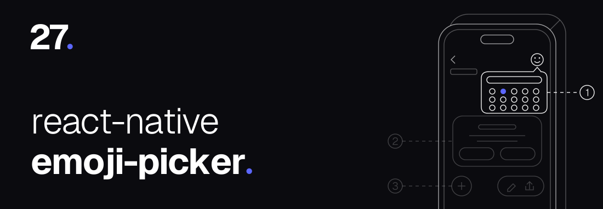
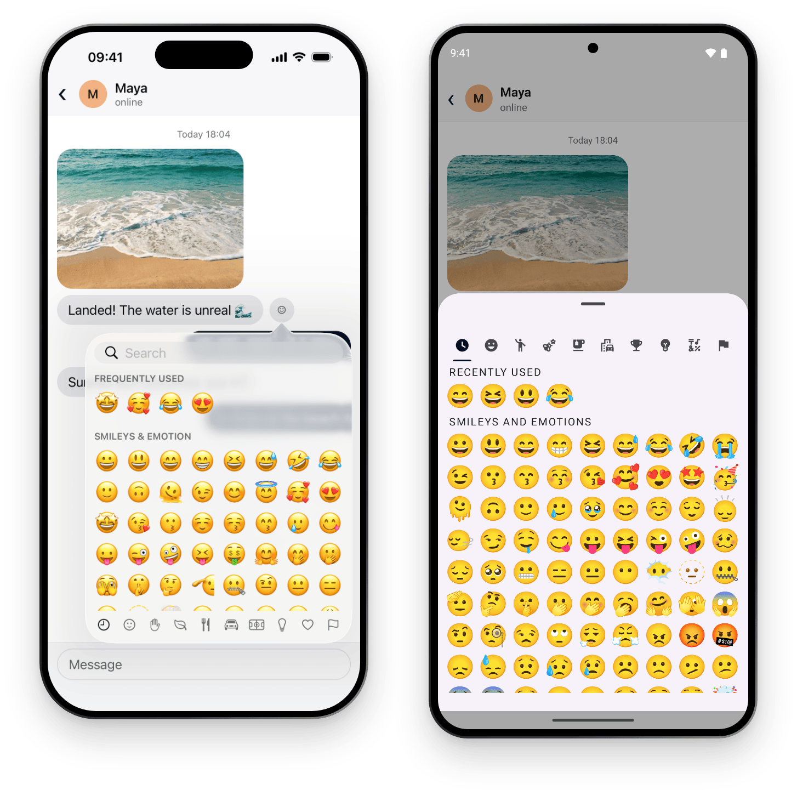
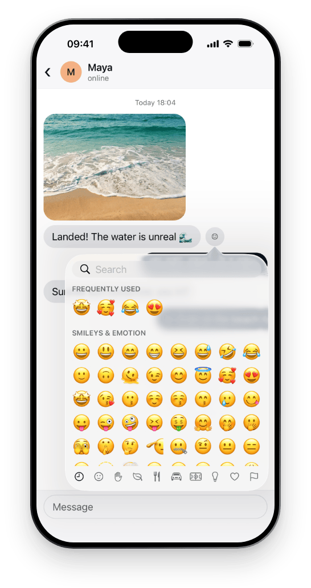
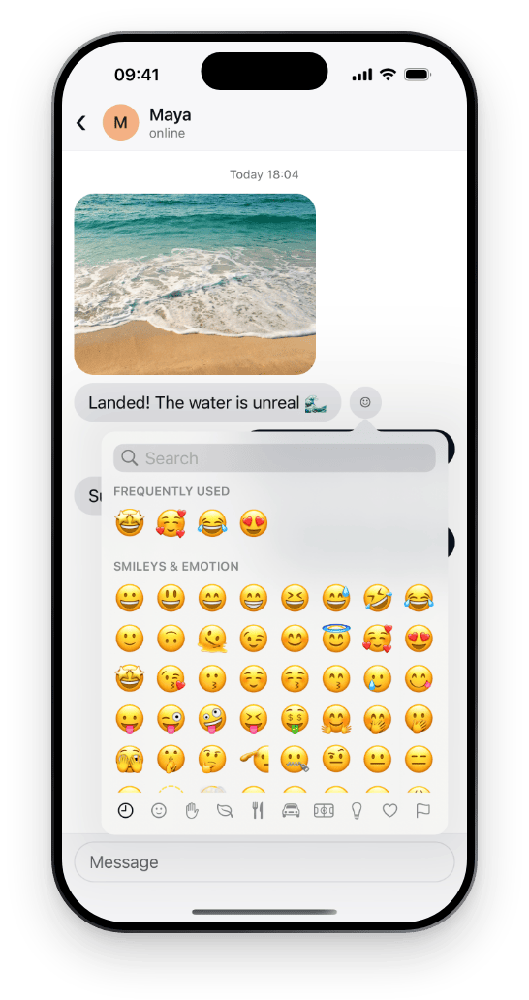
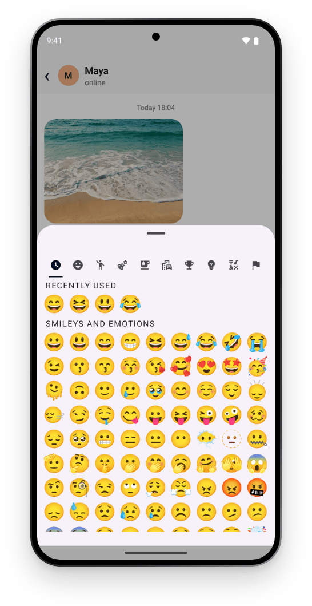

<h1></h1>

<p>
  <a href="https://www.npmjs.com/package/@27appstudio/react-native-emoji-picker"></a>
  <a href="https://github.com/27AppStudio/react-native-emoji-picker/actions/workflows/ci.yml"></a>
  <a href="#installation"></a>
  <a href="LICENSE"></a>
</p>

A native emoji picker for React Native, built from UIKit and Material 3 components rather than a JS list:

- **iOS**: a popover anchored to the view you pass, with search, recents, skin tones and a category bar. Its backgrounds are clear, so the popover's own material shows through: Liquid Glass on iOS 26, the system blur on earlier versions. It only uses public UIKit APIs. iOS has no public emoji picker, and the emoji keyboard can't be opened on its own without undocumented calls.
- **Android**: Google's `EmojiPickerView` (androidx.emoji2 1.7.0) in a Material 3 bottom sheet. It brings its own categories, skin tones, recents and emoji compatibility.

<p align="center"><picture><source media="(prefers-color-scheme: dark)" srcset="docs/images/hero-dark.png"></picture></p>

| iOS 26                                                                                                                                                                                                                                                                                                          | iOS 18                                                                                                                                                                                                               | Android                                                                                                                                                                                                                                                 |
| --------------------------------------------------------------------------------------------------------------------------------------------------------------------------------------------------------------------------------------------------------------------------------------------------------------- | -------------------------------------------------------------------------------------------------------------------------------------------------------------------------------------------------------------------- | ------------------------------------------------------------------------------------------------------------------------------------------------------------------------------------------------------------------------------------------------------- |
| <picture><source media="(prefers-color-scheme: dark)" srcset="docs/images/ios26-chat-dark.png"></picture> | <picture><source media="(prefers-color-scheme: dark)" srcset="docs/images/ios18-chat-dark.png"></picture> | <picture><source media="(prefers-color-scheme: dark)" srcset="docs/images/android-chat-dark.png"></picture> |

Photo by [Mink Mingle](https://unsplash.com/@minkmingle?utm_source=27appstudio_showcase&utm_medium=referral) on [Unsplash](https://unsplash.com/?utm_source=27appstudio_showcase&utm_medium=referral). The chat passes Splitify's default `tintColor`, ink in light mode and cream in dark mode. The scene is in [`example/src/Showcase.tsx`](example/src/Showcase.tsx), captured and framed by [`scripts/screenshots`](scripts/screenshots).

It's a TurboModule with an imperative API: no wrapper view, no Expo modules, no config plugin.

Built for [Splitify](https://splitify.cc).

## Installation

```sh
npm install @27appstudio/react-native-emoji-picker
cd ios && pod install
```

Requirements:

- React Native 0.82+ with the New Architecture
- **Android**: nothing more. The library ships `androidx.emoji2:emoji2-emojipicker` 1.7.0 and `com.google.android.material:material` 1.13. Your app theme can stay AppCompat: the sheet uses its own Material 3 theme (see [Android theme](#android-theme)).
- **Expo**: works in development builds, not in Expo Go.

## Usage

```tsx
import { useRef } from 'react';
import { Pressable, Text, View } from 'react-native';
import { openEmojiPicker } from '@27appstudio/react-native-emoji-picker';

function IconField({ value, onChange }) {
  const anchor = useRef<View>(null);

  const pick = async () => {
    const emoji = await openEmojiPicker(anchor, { tintColor: '#E8590C' });
    if (emoji !== null) {
      onChange(emoji);
    }
  };

  return (
    <Pressable ref={anchor} onPress={pick}>
      <Text>{value}</Text>
    </Pressable>
  );
}
```

## API

### `openEmojiPicker(anchor, options?): Promise<string | null>`

Opens the picker and resolves with the emoji picked, or with `null` when it was dismissed (a tap outside, a drag down, or back). A call made while the picker is already open resolves `null`.

`anchor` is what the iOS popover points at: a ref to a view, or the view itself (anything with `measureInWindow`). On Android it is ignored. Pass `null` to center the popover.

| Option               |                                                                                                                                                                                                                                                                        |
| -------------------- | ---------------------------------------------------------------------------------------------------------------------------------------------------------------------------------------------------------------------------------------------------------------------- |
| `tintColor`          | The selected category, and on iOS the search cursor and the keyboard's Done. Without it, iOS uses the system tint and Android the `colorAccent` of `Theme.RNEmojiPicker`.                                                                                              |
| `userInterfaceStyle` | `'light'`, `'dark'` or `'unspecified'` (default). Use it to follow an in-app appearance setting.                                                                                                                                                                       |
| `locale`             | iOS: the language of the search keywords and section titles, such as `'fr'` or `'pt-BR'`. Defaults to the app's language. The bundled languages are en, fr, es, de, it, pt, nl, ja, ko and zh; any other falls back to English. The Android picker follows the system. |

### `isAvailable: boolean`

`false` where the native module is missing (web, Expo Go). There, `openEmojiPicker` rejects.

## iOS details

- **Recents.** The last 24 picks are kept in `UserDefaults` and shown first.
- **Skin tones.** A long press on an emoji that takes skin tones opens a strip with the base emoji and its five tones. The tone picked is remembered for that emoji.
- **Newer emoji.** Emoji from a Unicode version the device can't draw are hidden: the picker checks that Apple Color Emoji renders each one as a single glyph. A new iOS release doesn't need a library update; a new Unicode release only needs the data regenerated.
- **Data.** The emoji, their order and their names in each language come from [emojibase](https://emojibase.dev) (Unicode and CLDR). The data is built with `yarn gen:emoji` into `ios/Resources`, and it adds about 1.7 MB before compression.

## Android theme

The sheet is built with the `Theme.RNEmojiPicker` style, a plain `Theme.Material3.DayNight.BottomSheetDialog`. To restyle it, redefine the style in your app's `android/app/src/main/res/values/styles.xml`. Your app's resources win over the library's:

```xml
<style name="Theme.RNEmojiPicker" parent="Theme.Material3.DayNight.BottomSheetDialog">
    <!-- The sheet -->
    <item name="colorSurfaceContainerLow">@color/sheet_background</item>
    <!-- The selected category -->
    <item name="colorAccent">@color/tint</item>
    <item name="android:colorAccent">@color/tint</item>
</style>
```

## Contributing

- [Development workflow](CONTRIBUTING.md#development-workflow)
- [Sending a pull request](CONTRIBUTING.md#sending-a-pull-request)
- [Code of conduct](CODE_OF_CONDUCT.md)

The example app has a Detox suite for iOS: start Metro with `yarn example start`, then run `yarn example detox test -c ios.sim.debug` (set `E2E_IOS_DEVICE` to choose a simulator).

## License

MIT

## react-native-emoji-picker is made by 27AppStudio

[27AppStudio](https://27appstudio.com) is an independent French mobile app studio. We build iPhone and Android apps, and open-source the native UI components and release tooling we make along the way. Need a hand with a React Native app? [Get in touch](https://27appstudio.com).
